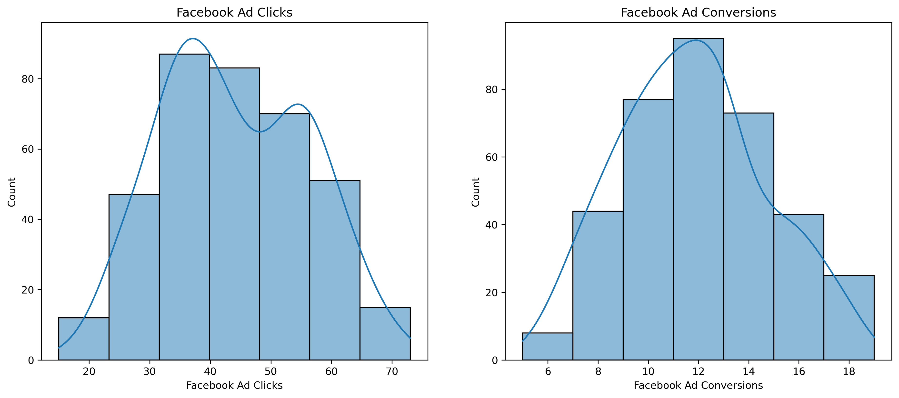
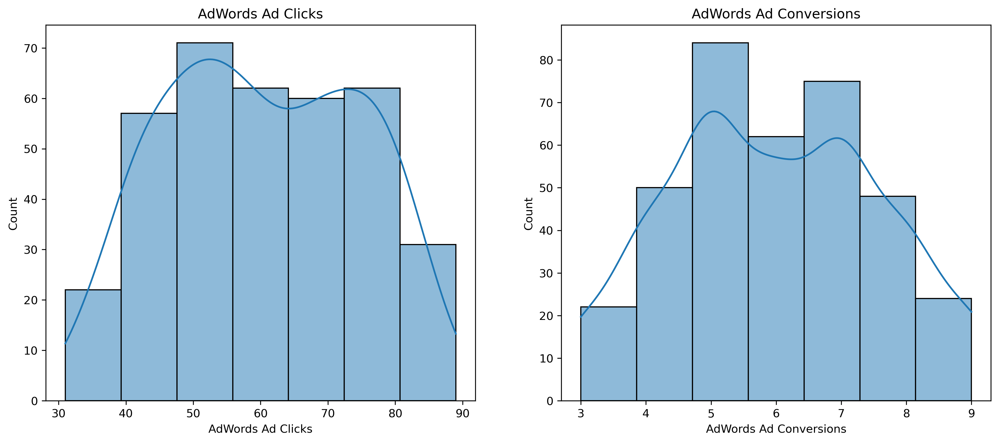
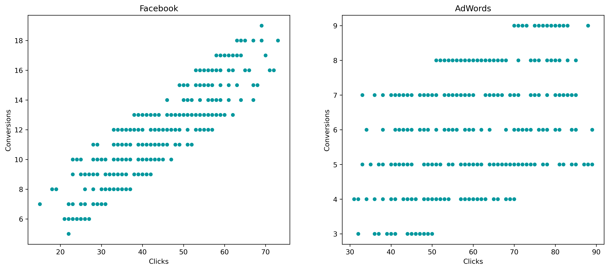
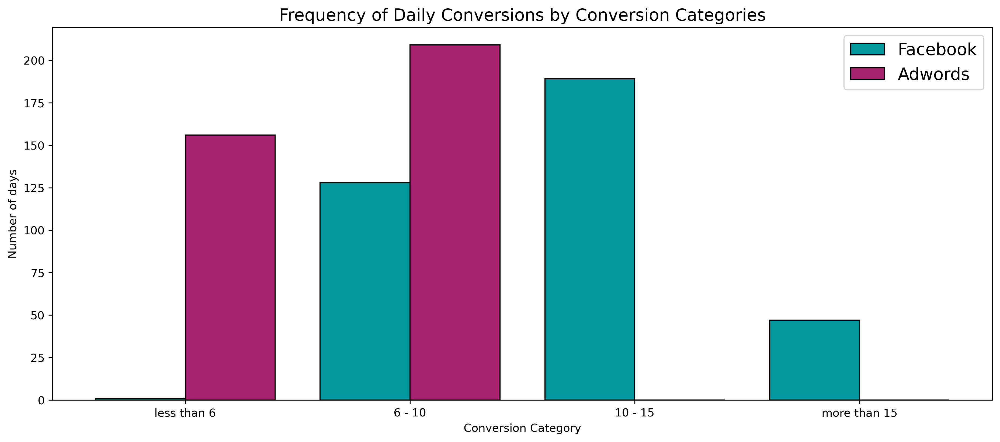
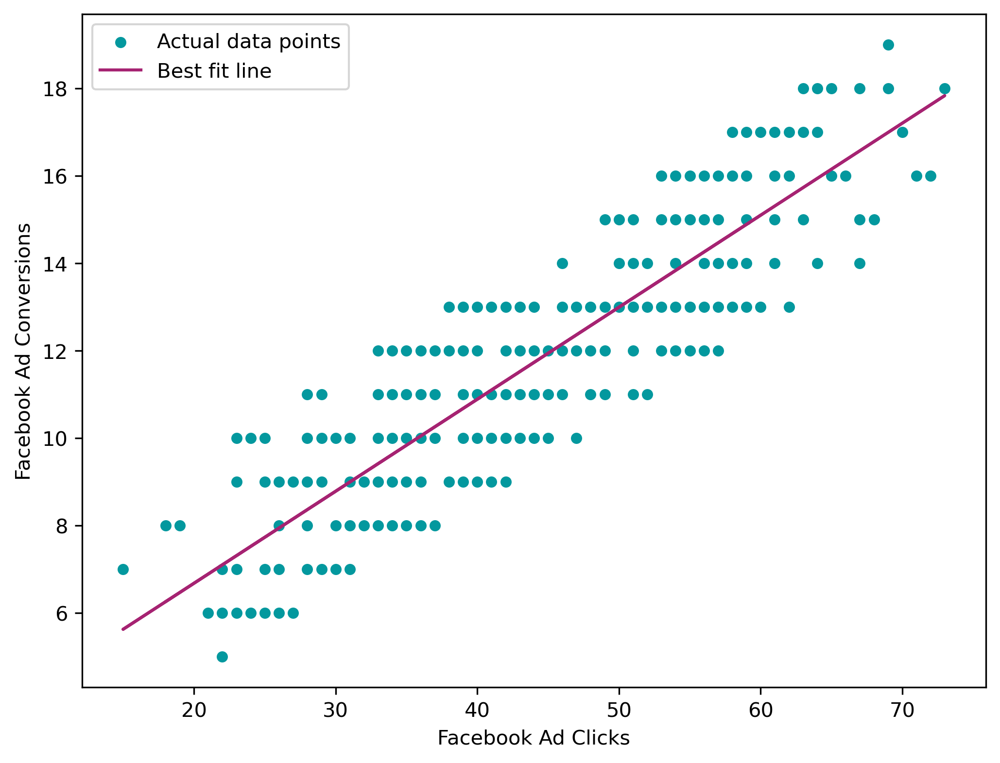
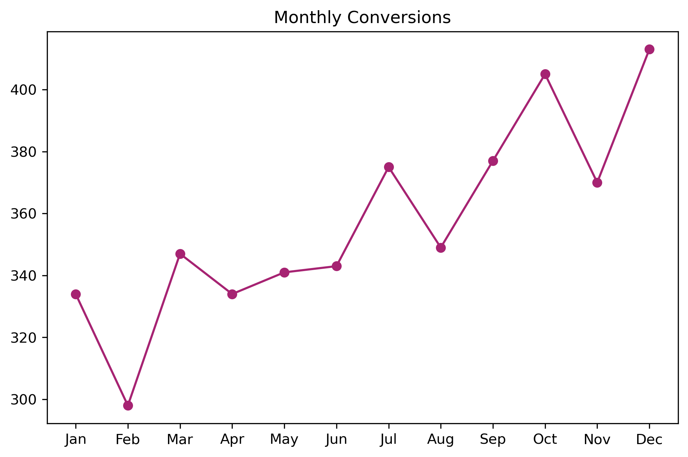
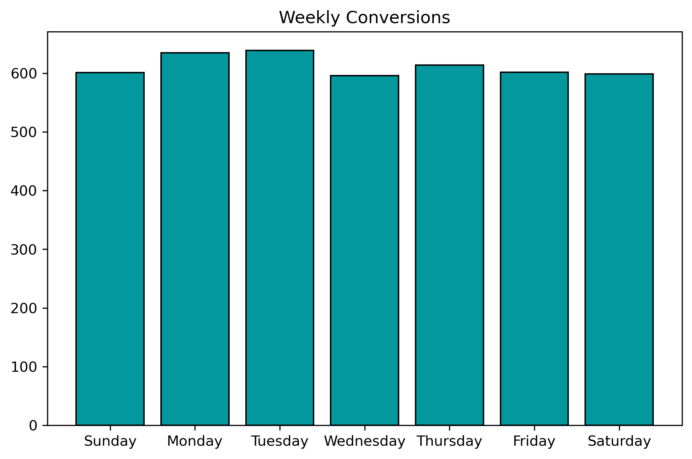
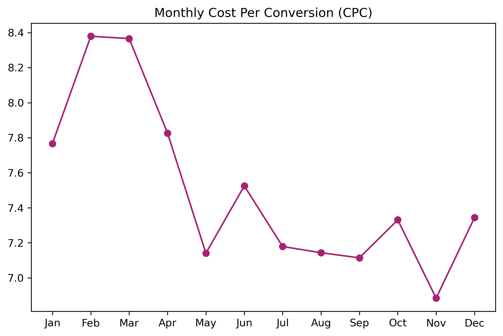

# 📊 Digital Ad Campaign Performance: A/B Testing & Regression Analysis

An end-to-end marketing analytics and data science project comparing **Facebook Ads vs. Google AdWords** using exploratory data analysis (EDA), statistical hypothesis testing, correlation analysis, and linear regression.

The project analyzes 365 daily observations from 2019 to evaluate advertising performance, conversion efficiency, customer engagement, and acquisition costs, translating data-driven findings into actionable marketing recommendations.

---

## 📌 Table of Contents

- [Business Problem & Objectives](#-business-problem--objectives)
- [Dataset Description](#-dataset-description)
- [Project Structure](#-project-structure)
- [Tools & Technologies](#-tools--technologies)
- [Project Workflow](#-project-workflow)
- [Key Analysis & Findings](#-key-analysis--findings)
- [Statistical Hypothesis Testing](#-statistical-hypothesis-testing-ab-test)
- [Regression Analysis](#-regression-analysis)
- [Temporal & Cost-Efficiency Analysis](#-temporal--cost-efficiency-analysis)
- [Business Insights & Recommendations](#-business-insights--recommendations)
- [How to Run the Project](#-how-to-run-the-project)
- [Skills Demonstrated](#-skills-demonstrated)
- [Conclusion](#-conclusion)

---

## 🎯 Business Problem & Objectives

Digital advertising teams must allocate limited marketing budgets across platforms while maximizing customer engagement, conversions, and return on advertising spend.

This project compares Facebook Ads and Google AdWords to answer the following business question:

**Which advertising platform delivers better conversion performance, and how can marketing teams use data to improve campaign efficiency?**

### Objectives

- Compare daily clicks, impressions, conversions, and advertising costs.
- Evaluate click-through rate (CTR), conversion rate, and cost per conversion.
- Identify patterns in campaign performance through exploratory data analysis.
- Measure relationships between advertising clicks and conversions.
- Test whether Facebook's average daily conversions are significantly higher than Google AdWords'.
- Build a regression model to estimate Facebook conversions from click volume.
- Identify weekly and monthly trends to support campaign planning.
- Translate analytical findings into actionable budget allocation and optimization strategies.

---

## 📁 Dataset Description

The project uses `marketing_campaign.csv`, containing daily marketing campaign observations for Facebook Ads and Google AdWords across 2019.

- **Time period:** January 1, 2019 – December 31, 2019
- **Observation frequency:** Daily
- **Number of observations:** 365 daily records, as described by the project analysis
- **Platforms compared:** Facebook Ads and Google AdWords

### Dataset variables

The dataset contains campaign performance metrics for the two advertising platforms. The exact original column names should be verified against the CSV file.

| Variable | Description |
|---|---|
| Date | Date of campaign observation |
| Ad Views | Number of ad impressions |
| Ad Clicks | Number of clicks generated |
| Ad Conversions | Number of desired actions or sales |
| Cost per Ad | Advertising expenditure |
| Click-Through Rate (CTR) | Percentage of impressions resulting in clicks |
| Conversion Rate | Percentage of clicks resulting in conversions |
| Cost per Click (CPC) | Average advertising cost per click |

**Derived metrics**

CTR:

\[
CTR = \frac{\text{Clicks}}{\text{Impressions}}\times100
\]

Conversion Rate:

\[
CVR = \frac{\text{Conversions}}{\text{Clicks}}\times100
\]

Cost per Click:

\[
CPC = \frac{\text{Total Ad Spend}}{\text{Clicks}}
\]

Cost per Conversion:

\[
CPA = \frac{\text{Total Ad Spend}}{\text{Conversions}}
\]

*Note: Cost per click and cost per conversion are different metrics. The analysis should use the formula matching the actual cost and performance columns in the dataset.*

---

## 🗂️ Project Structure

```text
Ad Campaign Performance: AB Testing & Regression/
│
├── data/
│   ├── README.md
│   └── marketing_campaign.csv
│
├── notebook/
│   └── Marketing Campaign Analysis.ipynb
│
├── visuals/
│   ├── README.md
│   ├── adwords_clicks_conversions.png
│   ├── clicks_vs_conversions_scatter.png
│   ├── daily_conversions_by_category.png
│   ├── facebook_clicks_conversions.png
│   ├── facebook_regression_fit.png
│   ├── monthly_conversions.png
│   ├── monthly_cost_per_conversion.png
│   └── weekly_conversions.png
│
└── README.md
```

The root README documents the complete project, the `data/` directory contains the dataset and its documentation, the `notebook/` directory contains the analysis, and the `visuals/` directory stores the generated charts.

---

## 🛠️ Tools & Technologies

| Technology | Purpose |
|---|---|
| Python | Core programming and analysis |
| pandas | Data cleaning, transformation, and aggregation |
| NumPy | Numerical computations and vectorized operations |
| Matplotlib | Data visualization |
| Seaborn | Statistical plots and distribution analysis |
| SciPy | Statistical hypothesis testing |
| statsmodels | Statistical modeling and OLS regression analysis |
| scikit-learn | Regression modeling and evaluation metrics |
| Jupyter Notebook | Interactive analysis and documentation |

---

## 🔄 Project Workflow

### 1. Data Cleaning & Preprocessing

The raw campaign dataset was prepared for analysis through the following steps:

- Loaded the CSV file into a pandas DataFrame.
- Inspected column names, data types, missing values, and duplicate records.
- Converted date values into Python datetime format.
- Cleaned currency and percentage fields where applicable.
- Converted analytical variables into suitable numeric data types.
- Created additional time-based features such as month and weekday.
- Checked data consistency before performing statistical analysis.

**Objective:** Ensure the data is structured and reliable for further analysis.

### 2. Exploratory Data Analysis (EDA)

EDA was used to understand the distribution and performance of both advertising platforms.

The analysis examined:

- Click and conversion distributions.
- Daily engagement and conversion patterns.
- Outliers and variations in campaign performance.
- Conversion frequency categories.
- Differences between Facebook Ads and Google AdWords.

#### Conversion frequency analysis

Daily conversions were grouped into the following performance categories:

- Fewer than 6 conversions
- 6–10 conversions
- 10–15 conversions
- More than 15 conversions

The reported analysis found that Facebook recorded 189 days in the 10–15 conversion category and 47 days above 15 conversions. Google AdWords recorded no days above 10 conversions.

These findings suggest that Facebook delivered stronger daily conversion volume in this dataset.

### 3. Correlation Analysis

Correlation analysis measured the strength and direction of the linear relationship between clicks and conversions.

| Advertising platform | Reported correlation | Interpretation |
|---|---:|---|
| Facebook Ads | 0.87 | Strong positive linear relationship |
| Google AdWords | 0.45 | Moderate positive linear relationship |

Facebook's higher correlation suggests that daily click volume was more closely associated with daily conversions.

However, correlation does not establish causation or directly measure conversion efficiency. Conversion rates, acquisition costs, and other campaign factors should also be considered.

### 4. Statistical Hypothesis Testing (A/B Test)

An independent two-sample Welch's t-test was used to assess whether Facebook's mean daily conversions exceeded Google AdWords'.

The test evaluates the difference in average conversions while allowing the two groups to have unequal variances.

### 5. OLS Linear Regression

An Ordinary Least Squares (OLS) regression model was developed to estimate Facebook conversions from clicks.

The model helps quantify the relationship between click volume and expected conversion volume.

### 6. Temporal & Cost-Efficiency Analysis

Time-based analysis examined:

- Differences in conversions by weekday.
- Monthly conversion trends.
- Seasonal changes in campaign activity.
- Cost per conversion across months.
- Potential periods for adjusting campaign budgets.

---

## 📈 Key Analysis & Findings

### Facebook Ads vs. Google AdWords

| Metric | Facebook Ads | Google AdWords |
|---|---:|---:|
| Mean daily conversions | 11.74 | 5.98 |
| Clicks-to-conversions correlation | 0.87 | 0.45 |
| Reported days with more than 10 conversions | Frequently | 0 |

Based on the reported figures, Facebook generated approximately twice the average daily conversions of Google AdWords.

The observed conversion difference motivates further statistical evaluation and cost-efficiency comparisons.

### Visualizations

The following figures are generated by the analysis notebook and stored in `visuals/`.

#### Clicks and conversions





#### Clicks vs. conversions relationship



#### Daily conversion frequency



#### Regression model



#### Monthly and weekly performance





#### Cost efficiency



*If a chart does not render on GitHub, verify that the image exists in the `visuals/` folder and that the relative filename and capitalization match exactly.*

---

## 🧪 Statistical Hypothesis Testing: A/B Test

### Research question

Does Facebook Ads generate significantly higher average daily conversions than Google AdWords?

### Hypotheses

Let \(\mu_F\) represent mean daily Facebook conversions and \(\mu_G\) represent mean daily Google AdWords conversions.

- **Null hypothesis (\(H_0\)):** \(\mu_F \leq \mu_G\)
- **Alternative hypothesis (\(H_1\)):** \(\mu_F > \mu_G\)

### Test selection

**Welch's independent two-sample t-test**

This test compares the means of two independent groups without assuming equal population variances.

### Reported results

| Statistical measure | Result |
|---|---:|
| Facebook mean daily conversions | 11.74 |
| Google AdWords mean daily conversions | 5.98 |
| t-statistic | 32.88 |
| p-value | \(9.35 \times 10^{-134}\) |
| Significance level | 0.05 |

### Interpretation

The reported p-value is substantially below the 0.05 significance level. Therefore, the null hypothesis is rejected in favor of the alternative hypothesis.

**Conclusion:** The observed data provides very strong statistical evidence that Facebook's mean daily conversions were higher than Google AdWords' during the analyzed period.

*Methodological note: This interpretation assumes the observations and test implementation satisfy the test's assumptions. Because the records are daily time-series observations, serial dependence and day-of-week effects should be checked before treating the nominal p-value as definitive. This comparison is observational rather than a randomized user-level A/B experiment.*

---

## 📉 Regression Analysis

### Objective

Estimate Facebook conversions using the number of clicks as the predictor variable.

### Model

\[
\text{Conversions} = \beta_0 + \beta_1(\text{Clicks}) + \epsilon
\]

Where:

- \(\beta_0\): Intercept
- \(\beta_1\): Estimated change in conversions for one additional click
- Clicks: Independent variable
- Conversions: Dependent variable
- \(\epsilon\): Model error

### Reported model performance

| Metric | Result |
|---|---:|
| Coefficient of determination (\(R^2\)) | 76.35% |
| Mean Squared Error (MSE) | 2.02 |

### Interpretation

The reported \(R^2\) indicates that the fitted linear model explains approximately 76.35% of the observed variation in Facebook conversions within the evaluated data.

The MSE summarizes the average squared prediction error, with lower values indicating better fit on the same evaluation basis.

### Illustrative scenario projections

The original analysis reported the following approximate projections:

| Click volume | Estimated conversions |
|---:|---:|
| 50 clicks | 13 |
| 80 clicks | 19 |

These are illustrative predictions, not guaranteed outcomes. They should be checked against the fitted model's actual coefficients and the click-volume range represented in the training data.

**Model limitation:** A high in-sample \(R^2\) does not establish future predictive accuracy. A chronological holdout set, residual analysis, and comparison with a baseline model would strengthen the evaluation.

---

## 📅 Temporal & Cost-Efficiency Analysis

### Weekly conversion patterns

The reported weekday analysis identified Monday and Tuesday as strong conversion days.

**Business implication:** These patterns can guide experiments with weekday-specific budgets and bids. They should be validated over additional periods before committing to a permanent schedule.

### Monthly conversion patterns

Monthly analysis indicated an overall upward trend in conversions, with reported dips in February, April, and November.

These patterns can help marketing teams identify seasonal fluctuations and evaluate campaign planning assumptions.

### Cost per conversion

The reported analysis described acquisition costs as generally ranging from approximately $7.00 to $8.50 per conversion, with May and November identified as comparatively cost-efficient periods.

**Important distinction:** Confirm whether the plotted measure is cost per conversion or cost per click. Cost per conversion is calculated as total spend divided by conversions; cost per click is total spend divided by clicks. Any recommendation to scale spending should be supported by the correct metric and comparable monthly totals.

---

## 💡 Business Insights & Recommendations

### 1. Evaluate budget allocation by conversion performance

Facebook showed higher reported average daily conversions and a stronger clicks-to-conversions correlation.

**Recommendation:** Prioritize further budget-allocation experiments on Facebook while evaluating cost per conversion, conversion quality, and return on ad spend. Higher conversion volume alone does not guarantee higher profitability.

### 2. Investigate Google AdWords performance

The lower clicks-to-conversions correlation indicates a weaker linear association in the observed data.

**Recommendation:** Review search intent, keyword targeting, ad copy, landing-page relevance, and the conversion funnel. Segment results by campaign and keyword to identify where improvements are most likely.

### 3. Test weekday-specific budget strategies

Monday and Tuesday appeared to be stronger conversion days in the reported analysis.

**Recommendation:** Run controlled scheduling experiments to determine whether increased weekday spending produces incremental conversions at an acceptable cost.

### 4. Use regression for planning, not guarantees

The fitted model provides a starting point for estimating conversion volume from click volume.

**Recommendation:** Use validated predictions to establish planning scenarios, then compare predicted conversions against actual results and update the model as new data becomes available.

### 5. Optimize based on acquisition costs

Monthly cost efficiency may vary even when conversion volume is high.

**Recommendation:** Compare cost per conversion and return on ad spend across platforms and months before increasing budgets. Investigate whether apparent low-cost periods remain efficient after accounting for spend and conversion volume.

---

## 🚀 How to Run the Project

### Prerequisites

- Python 3.10 or later
- Git
- Jupyter Notebook

### Step 1: Clone the repository

```bash
git clone https://github.com/seema-kri/data-portfolio.git
cd data-portfolio
```

### Step 2: Navigate to the project folder

```bash
cd "python-projects/Ad Campaign Performance: AB Testing & Regression"
```

Adjust the path if the directory name in your repository differs.

### Step 3: Create a virtual environment

**Windows:**

```bash
python -m venv venv
venv\Scripts\activate
```

**macOS/Linux:**

```bash
python3 -m venv venv
source venv/bin/activate
```

### Step 4: Install dependencies

```bash
python -m pip install --upgrade pip
pip install pandas numpy matplotlib seaborn scipy scikit-learn statsmodels jupyter
```

### Step 5: Launch the notebook

```bash
jupyter notebook "notebook/Marketing Campaign Analysis.ipynb"
```

### Step 6: Run the analysis

1. Execute the notebook cells in order.
2. Confirm that `marketing_campaign.csv` is loaded from the correct relative path.
3. Review the cleaning steps and calculated metrics.
4. Run the statistical tests and regression model.
5. Generate the plots and save them into `visuals/`.

---

## 🎓 Skills Demonstrated

This project demonstrates practical skills relevant to data analyst, marketing analyst, and entry-level data science roles.

- **Python programming:** pandas, NumPy, and vectorized data operations.
- **Data cleaning:** Date conversion, type handling, data validation, and preprocessing.
- **Exploratory data analysis:** Distribution analysis, trend identification, and outlier inspection.
- **Statistical analysis:** Correlation, hypothesis testing, p-values, and statistical interpretation.
- **Machine learning:** Linear regression and model evaluation using \(R^2\) and MSE.
- **Data visualization:** Scatter plots, distribution charts, and temporal trend analysis.
- **Business analytics:** Campaign comparison, acquisition-cost analysis, and budget recommendations.
- **Analytical communication:** Converting quantitative results into business-oriented conclusions.

---

## 🔍 Future Improvements

Potential extensions to make the analysis more robust include:

- Validate statistical results using confidence intervals and effect sizes.
- Check temporal autocorrelation and account for weekday and seasonal effects.
- Evaluate regression performance using a chronological train-test split.
- Compare linear regression with additional models where appropriate.
- Add cost per conversion, conversion rate, and return on ad spend comparisons.
- Investigate whether differences remain after controlling for spend, impressions, and campaign mix.
- Introduce an interactive dashboard for ongoing campaign monitoring.

---

## 🏁 Conclusion

This project demonstrates an end-to-end approach to digital advertising analytics, combining data preparation, exploratory analysis, statistical hypothesis testing, regression modeling, and business interpretation.

Based on the reported 2019 observations, Facebook Ads generated higher average daily conversions and exhibited a stronger linear relationship between clicks and conversions than Google AdWords.

The analysis provides a foundation for campaign optimization and budget planning while highlighting the importance of validating statistical assumptions, evaluating acquisition costs, and testing predictive models on unseen data.

**The central takeaway:** Effective advertising decisions should be based not only on conversion volume, but also on statistical reliability, acquisition cost, conversion quality, and measurable business return.

---

*Project category: Marketing Analytics | Data Analysis | Statistical Hypothesis Testing | Regression Modeling*

